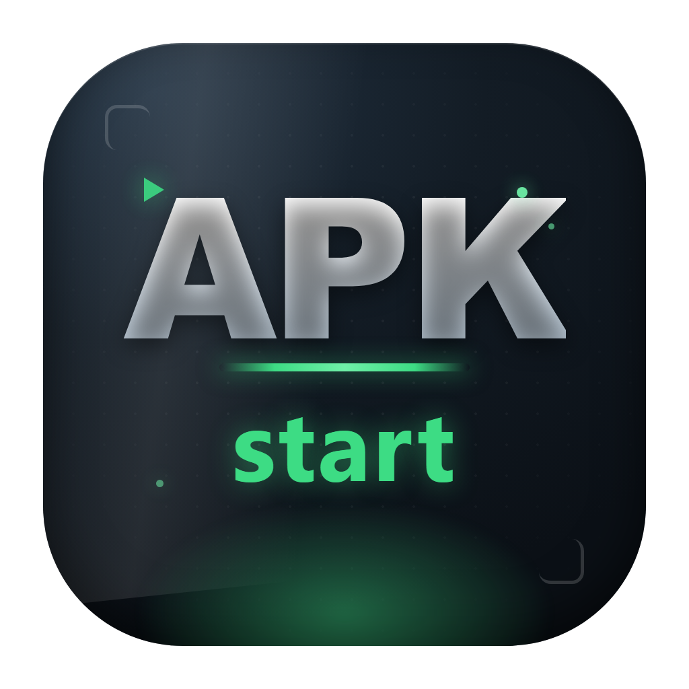
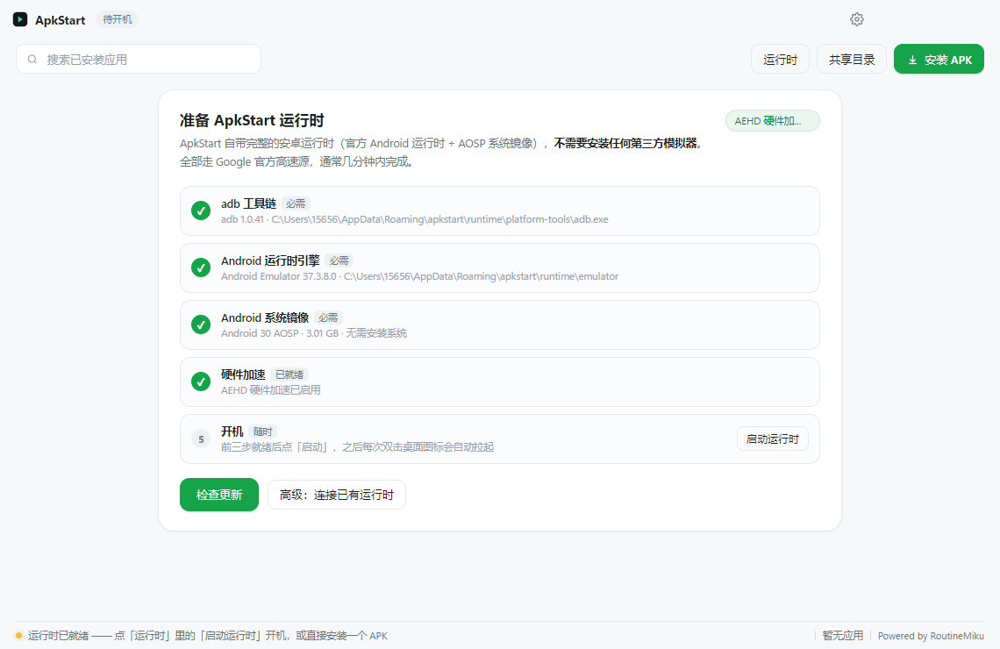
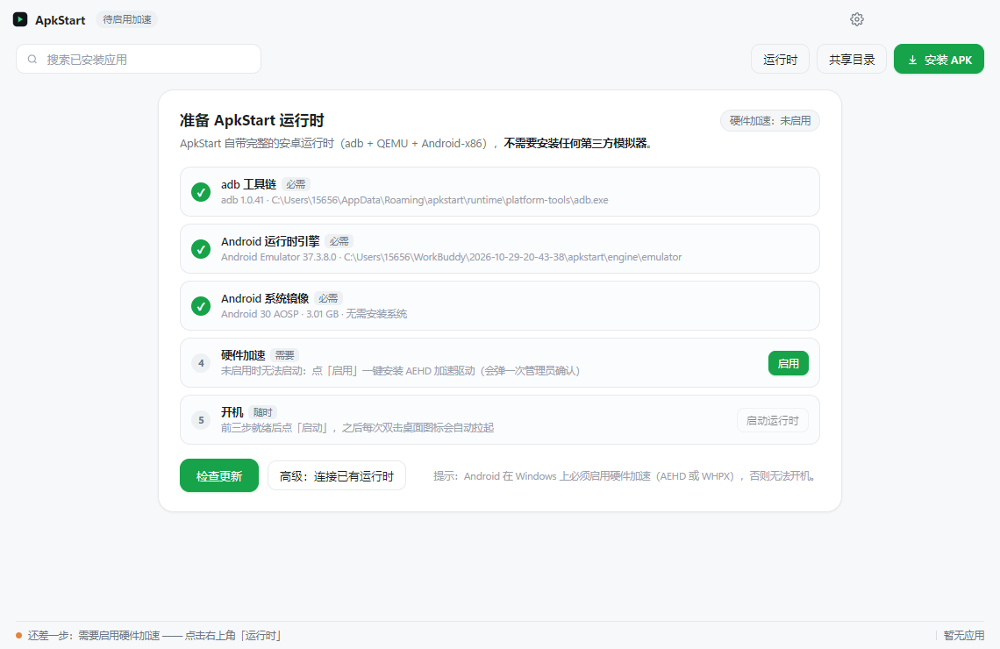
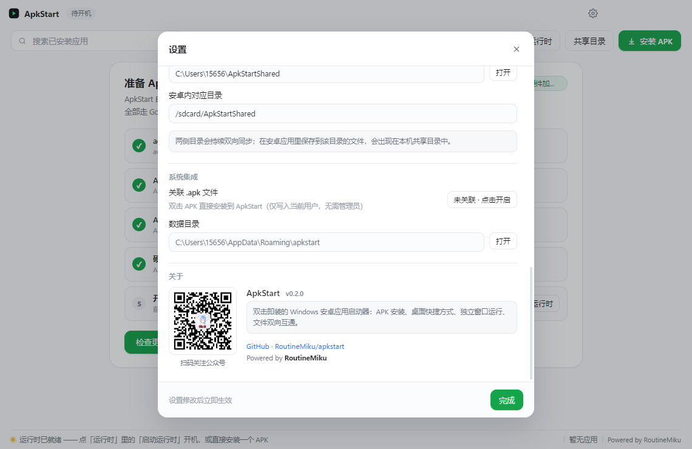

# ApkStart

<p align="center"></p>

[](https://github.com/RoutineMiku/apkstart/actions/workflows/ci.yml)
[](https://github.com/RoutineMiku/apkstart/releases)
[](LICENSE)
[](#)

**Trình chạy ứng dụng Android trên Windows — cài đặt và sử dụng ứng dụng Android như phần mềm Windows gốc.**

- 🖱️ **Nhấp đúp .apk là cài**: sau khi đăng ký liên kết tệp .apk, chỉ cần nhấp đúp APK trong File Explorer là tự động phân tích → cài đặt → tạo biểu tượng trên màn hình, hoàn toàn không cần mở giao diện trình giả lập nào.
- 🧩 **Mỗi ứng dụng một biểu tượng trên màn hình**: biểu tượng được trích xuất ngoại tuyến từ bên trong APK và chuyển thành ICO nhiều kích thước; nhấp đúp biểu tượng = khởi động thẳng ứng dụng đó, trải nghiệm giống hệt mở một phần mềm Windows gốc.
- 🪟 **Ứng dụng chính là một cửa sổ**: runtime khởi động ở chế độ **có cửa sổ** (ở chế độ headless, Android không phát VSYNC, tiến trình ứng dụng vẫn sống nhưng màn hình trống trơn); ApkStart đổi tiêu đề cửa sổ đó, thay bằng biểu tượng thật của ứng dụng, đặt theo tỉ lệ màn hình dọc — thành một cửa sổ ứng dụng độc lập; **toàn màn hình** phủ kín chiều cao màn hình và căn giữa, **chế độ cửa sổ** có thể kéo thả, co giãn tự do và ghi nhớ kích thước theo từng ứng dụng.
- 🔍 **Windows tìm kiếm được**: sau khi cài sẽ tạo cả lối tắt trên màn hình + menu Start (`Programs\ApkStart\`), gõ tên ứng dụng trong menu Start là mở được ngay, thanh tác vụ nhóm theo từng ứng dụng.
- 📁 **Dữ liệu thông suốt**: `%USERPROFILE%\ApkStartShared` ↔ `/sdcard/ApkStartShared` trong Android được đồng bộ hai chiều liên tục, tệp do ứng dụng Android lưu sẽ xuất hiện ngay trên máy.
- 🪶 **Cực kỳ nhẹ**: bản thân lớp vỏ không có phụ thuộc bên thứ ba nào (kể cả bộ phân tích ZIP / PNG / ICO / AXML cũng tự viết tay), runtime chỉ khởi chạy khi cần và tự thu hồi khi rảnh; cũng có thể tái sử dụng hoàn toàn runtime Android sẵn có trên máy bạn, không tốn thêm tài nguyên.



```
┌────────────────────────────────────────────────────────────┐
│  Biểu tượng màn hình (.lnk với biểu tượng thật của app)    │
│      │  nhấp đúp                                           │
│      ▼                                                     │
│  ApkStart.exe --launch <tên gói>                           │
│      │  runtime chưa chạy? → tự khởi động (Emulator+API34) │
│      ▼                                                     │
│  Khởi động theo LAUNCHER do hệ thống phân giải             │
│  (không phải Activity chính khai báo trong APK)            │
│      │  theo dõi 18s; crash → thử lại / reset / cấp quyền  │
│      ▼                                                     │
│  Cửa sổ trình giả lập = cửa sổ ứng dụng                    │
│  (đổi tiêu đề, đổi biểu tượng, tỉ lệ dọc, toàn màn hình)   │
└────────────────────────────────────────────────────────────┘
```

## Tải về dùng ngay (không cần biên dịch)

Hai nguồn có nội dung giống nhau, người dùng ở Trung Quốc nên dùng Gitee:

- GitHub: [github.com/RoutineMiku/apkstart/releases](https://github.com/RoutineMiku/apkstart/releases)
- Gitee: [gitee.com/daily-miku/apkstart/releases](https://gitee.com/daily-miku/apkstart/releases) (kết nối trực tiếp từ Trung Quốc nhanh hơn nhiều)

Gói cài đặt:

- **`ApkStart-v*-Setup.exe`** (khoảng 1,3 GB): **một EXE chứa toàn bộ runtime** (adb / Android Emulator / ảnh hệ thống); sau khi cài, lần khởi động đầu tiên tự giải nén ảnh hệ thống vào thư mục người dùng, **sau đó không cần tải gì từ mạng nữa**. Cài vào thư mục của người dùng hiện tại, không yêu cầu quyền quản trị.
- Ngoài ra có bản nhẹ `ApkStart-v*-win64-portable.zip` (**95 MB**, giải nén ra khoảng 226 MB): chỉ tải runtime ở nền khi khởi động lần đầu. Nguồn tải runtime chính là **GitHub Release của dự án này** (gói trọn `ApkStart-runtime-*.zip`), không đi qua dl.google.com; chỉ khi không lấy được gói trọn mới tự quay về nguồn chính thức.

### Cập nhật trực tuyến (tự chọn nguồn nhanh hơn)

Cài đặt → **Cập nhật phần mềm** → "Kiểm tra cập nhật", hoặc nhấp phải khay hệ thống → "Kiểm tra cập nhật". Khi có phiên bản mới, bấm "Cập nhật ngay" là xong.

- Bản cài đặt tải `ApkStart-v*-Setup.exe` và cài im lặng;
- Bản nhẹ tải `ApkStart-v*-win64-portable.zip`, giải nén rồi ghi đè **thư mục chương trình** — thư mục runtime (`%APPDATA%\apkstart\runtime`), ứng dụng đã cài và snapshot đều không nằm trong thư mục chương trình, nên cập nhật không làm mất gì;
- Việc thay thế do một script PowerShell độc lập đảm nhận (chờ tiến trình chính thoát → ghi đè → khởi động lại), **không xuất hiện hộp thoại "vui lòng tự đóng chương trình"**, cũng không để sót cửa sổ trình giả lập trên màn hình.

Kênh cập nhật không gắn cứng vào GitHub mà **đo và chọn lại mỗi lần**:

1. Hỏi đồng thời phiên bản mới nhất trên GitHub và Gitee, lấy bên có số phiên bản cao hơn (một nguồn bị timeout/chặn không ảnh hưởng nguồn kia);
2. Liệt kê "kết nối trực tiếp tới nguồn gốc / tài sản cùng tên trên Gitee / tiền tố mirror" làm ứng viên, mỗi địa chỉ tải thật 256KB để đo tốc độ,
   chỉ tính thông lượng "sau khi nhận byte đầu tiên" (không tính thời gian bắt tay, nếu không nguồn có độ trễ cao nhưng băng thông lớn sẽ bị đánh giá nhầm là chậm);
3. Sắp xếp theo tốc độ đo được, dùng đường nhanh nhất để tải song song theo khối; lỗi thì tự chuyển sang đường kế tiếp.

Mục "Nguồn tải và cập nhật" trong Cài đặt cho phép ép chỉ dùng một bên (dùng khi mạng doanh nghiệp chỉ cho phép một tên miền),
cũng có thể tắt mirror tăng tốc công cộng hoặc dùng tiền tố mirror tự dựng. Gitee giới hạn mỗi tệp đính kèm 100MB,
gói portable sau khi chuyển sang nén deflate của 7-Zip (`-mx=9`) còn **95.0MB**, nên trên Gitee cũng là
một gói trọn có thể nhấp đúp giải nén trực tiếp (trước đây phải cắt thành `.part1/.part2` rồi ghép thủ công, cách đó đã bỏ).
Gói cùng tên ở hai nguồn có dung lượng không hoàn toàn giống nhau; client chỉ chọn một nguồn theo kết quả đo tốc độ để tải trọn, không ghép lẫn.

Cả hai kho đều công khai, danh sách phát hành trên Gitee đọc ẩn danh được, không cần điền token nào.
(Chỉ khi Gitee giới hạn tần suất và trả về 403/429 mới cần điền một token chỉ đọc trong Cài đặt để tăng hạn mức.)


**Hành vi mặc định có sẵn** (không cần vào Cài đặt tìm):

- Tự khởi động cùng máy, thường trú ở khay hệ thống; nhấp đúp biểu tượng trên màn hình là vào thẳng ứng dụng.
- Sau khi cài APK sẽ tự tạo hai lối tắt **màn hình + menu Start**, Windows Search tìm được trực tiếp theo tên ứng dụng; lối tắt bị thiếu từ phiên bản cũ sẽ được tự bổ sung khi khởi động.
- Cửa sổ ứng dụng được kết xuất gốc (không phải chiếu màn hình): **toàn màn hình** phủ kín chiều cao màn hình và căn giữa, giữ nguyên tỉ lệ điện thoại không méo; **chế độ cửa sổ** giữ màn hình dọc, kéo thả co giãn tự do, kích thước mỗi ứng dụng được ghi nhớ riêng. Có thể chuyển bất cứ lúc nào bằng `F11` hoặc nhấp phải khay hệ thống.
- Sau khi cài sẽ tự cấp các quyền runtime mà ứng dụng yêu cầu, không bị kẹt ở hộp thoại cấp quyền của hệ thống; ứng dụng bị crash sẽ tự thử lại, khi cần sẽ reset dữ liệu ứng dụng rồi khởi động lại.
- **Mạng dùng thẳng mạng của máy chủ**: phía Android đi qua NAT chế độ người dùng của QEMU, lưu lượng ra ngoài tái sử dụng card mạng vật lý của máy, **không tạo bất kỳ card mạng ảo / switch ảo nào trên Windows** (không cần cài driver, cũng không thêm network adapter). Không cần tải gì qua mạng, không cần đổi bất kỳ thiết lập mạng nào.

## Build từ mã nguồn

```powershell
# 1. Cài phụ thuộc (bao gồm runtime Electron)
npm install

# 2. Khởi động và hoàn tất triển khai runtime (tải một lần adb / Android Emulator / ảnh hệ thống)
npm start

# 3. (Tùy chọn) Đăng ký nhấp đúp .apk để cài
npm run assoc:on

# 4. Đóng gói bản portable (không cần cài, phân phối trực tiếp được)
npm run pack
# Kết quả: dist/ApkStart-win64-portable/ApkStart.exe
# 5. Nén thành zip để phát hành (bắt buộc dùng script này, đừng dùng Compress-Archive: lớn hơn 5MB, không vừa Gitee)
node build/zip.js dist/ApkStart-win64-portable ApkStart-win64-portable.zip
```

### EXE một tệp (tích hợp đủ runtime, cài xong không cần mạng)

Nếu muốn "gửi đi một EXE, người nhận nhấp đúp là chạy, không phải chờ tải", dùng cách này:

```powershell
# Trước tiên chỉnh engine/ thành runtime có thể phân phối (system.img nén cực hạn bằng xz/LZMA2, 3.1GB → khoảng 1.1GB;
# đồng thời cắt bỏ phần không dùng trong emulator: QEMU arm64, backend Vulkan, gói đa ngôn ngữ, công cụ qsn/tự kiểm tra, tài nguyên VR)
npm run runtime

# Sau đó đóng thành EXE bản cài đặt (target nsis của electron-builder, cài vào thư mục người dùng hiện tại)
npm run build:exe
# Kết quả: dist/release/ApkStart-<phiên bản>-Setup.exe
```

Thành phần dung lượng (đo thực tế): Electron khoảng 180MB, emulator sau khi rút gọn khoảng 480MB, ảnh hệ thống nén xz khoảng 1.1GB,
gói cài đặt cuối cùng khoảng 1.32GB (tiết kiệm khoảng 490MB so với phương án gzip). Giới hạn cứng không thể nén thêm nằm ở system.img
(đó chính là hệ thống Android, lại là ảnh được bảo vệ bằng verity, không thể cắt bỏ thành phần GMS từ bên ngoài).
Mạng mặc định đi qua NAT của máy chủ, không tạo card mạng ảo, nên cũng không phụ thuộc driver bổ sung nào.

Lần khởi động đầu tiên sẽ giải nén ảnh xz vào `%APPDATA%\apkstart\system-images` (khoảng 20 giây, chỉ làm một lần),
sau đó mỗi lần đều tái sử dụng trực tiếp. AVD và ứng dụng đã cài được lưu cố định tại `%APPDATA%\apkstart\avd`,
nên kể cả bản portable mỗi lần giải nén vào thư mục tạm cũng không bị mất.

## Về runtime: hoàn toàn độc lập, không phụ thuộc trình giả lập bên thứ ba nào

ApkStart là dự án **tự chủ**, toàn bộ thành phần runtime do chính nó tải, kiểm tra và quản lý (đặt tại `%APPDATA%\apkstart\runtime`).
Bản nhẹ mặc định tải gói trọn (`ApkStart-runtime-*.zip`) từ **GitHub Release của dự án này**, không lấy được mới quay về các nguồn chính thức trong bảng dưới:

| Thành phần | Nguồn | Dung lượng | Công dụng |
|---|---|---|---|
| adb (platform-tools) | Nguồn chính thức dl.google.com | ~8 MB | Cài/khởi động ứng dụng Android |
| Android Emulator | Nguồn chính thức dl.google.com (tải song song 8 luồng) | ~440 MB | Engine runtime (kèm mô hình thiết bị và dịch GPU) |
| Ảnh hệ thống Android 14 đa dụng (Google Play x86_64) | Nguồn chính thức dl.google.com | Ảnh gốc ~3.1 GB (sau xz ~1.1 GB) | Lớp nền duy nhất: chạy được ứng dụng x86, ứng dụng chỉ có thư viện ARM và GMS; ảnh chính là hệ thống, không cần cài |
| Driver AEHD (tùy chọn) | Nguồn chính thức dl.google.com | ~0.2 MB | Tăng tốc phần cứng (hoặc dùng "Virtual Machine Platform" WHPX của Windows) |

Khi dùng lần đầu, trang "Runtime" sẽ hướng dẫn hoàn tất các bước triển khai trên (**triển khai một chạm**):
1. adb, engine runtime và ảnh hệ thống được tải tự động (nguồn chính thức đo thực tế 10+ MB/s);
2. Triển khai xong sẽ **tự khởi động máy ảo**, sau đó nhấp đúp biểu tượng trên màn hình là tự khởi chạy, hoàn toàn liền mạch.



**Tương thích thiết bị (tự xử lý, không cần can thiệp)**

- Không có tăng tốc phần cứng thì tự lùi về mô phỏng phần mềm; khởi động thất bại sẽ tự thử lại tối đa 4 bộ tham số theo thứ tự "backend kết xuất → kiểu tăng tốc → bộ nhớ/khởi động nguội".
- `-gpu` tự chọn theo phiên bản engine (37.x dùng `software`, bản cũ dùng `swiftshader_indirect`), không còn dùng các chế độ đã lỗi thời.
- Bộ nhớ/số nhân tự suy ra theo RAM vật lý (2–4 GB / 2–4 nhân), phân vùng dữ liệu giảm từ 16 GB xuống 4 GB; cổng được chọn động trong số cổng trống, đường dẫn có ký tự Trung Quốc tự chuyển sang đường dẫn ngắn, tệp khóa AVD tự dọn.
- Nguyên nhân lỗi được dịch sang ngôn ngữ dễ hiểu kèm gợi ý khắc phục; trong Cài đặt có thể "Xuất báo cáo chẩn đoán".
- Tải tệp lớn mặc định **chia khối 8 luồng + tải tiếp khi gián đoạn**, nguồn không hỗ trợ Range tự lùi về một luồng.
- Người dùng nâng cao cũng có thể chuyển sang "Kết nối runtime có sẵn" trong Cài đặt (tái sử dụng cổng adb của WSA v.v.), nhưng đây chỉ là tùy chọn, không phải phụ thuộc.
- Lối nâng cao: cũng có thể dùng "Kết nối runtime có sẵn" trong Cài đặt để tái sử dụng cổng adb của trình giả lập khác đang chạy trên máy bạn (WSA / MuMu v.v.).

**Chạy kiểu container, chi phí thấp**

- **Lớp nền chỉ đọc**: `system-images/` chỉ một bản cho cả máy, mọi ứng dụng dùng chung, không còn lưu song song hai bộ ảnh AOSP + tương thích.
- **Lớp ghi mỏng**: một AVD duy nhất dùng dữ liệu người dùng dạng chênh lệch + snapshot quickboot có tên; sau khi đóng cửa sổ ứng dụng cuối cùng (lúc rảnh) sẽ lưu trạng thái bộ nhớ thành snapshot, lần sau khởi động bằng cách khôi phục thay vì khởi động nguội.
- **Làm nóng khi rảnh (bật mặc định)**: giống WSA / Yingyongbao bản PC (应用宝电脑版), ApkStart vừa khởi động là đã dựng sẵn môi trường Android ở nền (cửa sổ ẩn hoàn toàn), khi bấm vào ứng dụng chỉ còn một lệnh `am start`; cái giá là thường trú khoảng 1 GB RAM khi rảnh, có thể tắt trong Cài đặt.
- **Tăng tốc khởi động nguội**: kết quả dò tăng tốc và phiên bản engine được lưu cache xuống đĩa (vô hiệu theo dấu vân tay exe), bỏ qua việc liệt kê tiến trình `wmic` không cần thiết, dò khởi động chuyển sang chu kỳ thích ứng (từ 350ms), các lệnh chuẩn bị phía guest gộp thành một lượt adb; mỗi lần khởi động chờ ít hơn 5–10 giây.
- **`/data` do ApkStart tự tạo**: `userdata.img` trong ảnh hệ thống chính thức chỉ là tệp giữ chỗ 1 MB toàn số 0, việc định dạng thật vốn do công cụ SDK làm — chạy thẳng `emulator.exe` sẽ bỏ qua bước này, khiến `/data` không mount được, guest rơi vào vòng lặp khởi động lại recovery, biểu hiện là "đợi mấy phút vẫn không mở được". Nay lần khởi động đầu sẽ tự tạo một ext4 block 4 KB, có `ENCRYPT` (mã hóa cấp tệp) và `ext_attr` (nhãn SELinux), rồi dùng `qemu-img` + `resize2fs` đi kèm để mở rộng tới dung lượng cấu hình. Đo thực tế: khởi động nguội ~23 giây, trúng snapshot ~10 giây.
- Kiểm tra toàn vẹn snapshot: vỏ rỗng do việc lưu bị gián đoạn (chỉ có `snapshot.pb` vài chục byte) sẽ được nhận diện và dọn; emulator bản mới ghi `ram.bin` (bản cũ là `ram.img`), cả hai cách đặt tên đều được nhận, không còn đánh giá nhầm snapshot 3 GB vừa lưu thành vỏ rỗng rồi xóa.
- **Cửa sổ dòng lệnh hoàn toàn không xuất hiện**: cửa sổ console của qemu thuộc về `conhost.exe`, pid không khớp với qemu nên dựa vào danh sách trắng pid thì không ẩn được cái nào; tiến trình nền mạng `netsimd` của trình giả lập còn tự bật thêm một cửa sổ đen. Nay chuyển sang "bật chế độ chặn thường trú **trước khi** khởi động trình giả lập + dự phòng theo tên lớp/tiêu đề cửa sổ (emulator / qemu / netsim) + quét mỗi 120ms trong 90 giây đầu khởi động".
- **Mở phần mềm chỉ thấy giao diện phần mềm**: cửa sổ chính của trình giả lập (`Android Emulator - apkstart5554`) không bao giờ xuất hiện riêng trên màn hình — hoặc bị chặn ẩn đi, hoặc đã được `SetParent` nhúng vào cửa sổ ứng dụng. Khi đóng cửa sổ ứng dụng, nó sẽ được **tháo ra trước** khỏi cửa sổ chủ và ẩn đi, **rồi mới** hủy cửa sổ chủ (làm ngược thứ tự thì Windows sẽ gắn nó lại vào màn hình và hiện ra); sau khi ứng dụng thoát, proxy cửa sổ còn tiếp tục "canh" tối đa 3 phút, tránh việc trình giả lập thoát giữa chừng lúc khởi động lại hiện cửa sổ đen sau vài chục giây.
- **Tải khi cần**: chỉ khi gặp ứng dụng chỉ có thư viện gốc ARM mới bổ sung ảnh đa dụng; gói tách `.apks` / `.xapk` tự cài bằng `install-multiple`.
- **Có thể thu hồi**: khi build sẽ cắt bỏ các target QEMU không phải x86_64 (khoảng 400 MB); trang Cài đặt có thể dọn ảnh cũ, snapshot cũ, tệp khóa và AVD sót lại.

## Cấu trúc thư mục

```
apkstart/
├─ src/
│  ├─ main.js              Tiến trình chính: cửa sổ/khay/đơn thể hiện/phân phối dòng lệnh/IPC
│  ├─ preload.js           Cầu nối an toàn
│  ├─ ui/                  Lớp hiển thị (HTML/CSS/JS thuần, không framework)
│  └─ core/
│     ├─ zip.js            Bộ đọc ZIP tối giản (giải nén theo nhu cầu)
│     ├─ axml.js           Phân tích XML nhị phân Android
│     ├─ arsc.js           Phân tích bảng tài nguyên resources.arsc (khôi phục tên app/đường dẫn biểu tượng)
│     ├─ apk.js            Siêu dữ liệu APK: tên gói/phiên bản/Activity khởi động/biểu tượng/ABI
│     ├─ png.js            Bộ mã hóa PNG không phụ thuộc + vẽ biểu tượng chương trình
│     ├─ shortcut.js       Tạo ICO nhiều kích thước + lối tắt .lnk
│     ├─ assoc.js          Liên kết tệp .apk (HKCU, không cần quản trị)
│     ├─ adb.js            Client adb (cài/khởi động/đồng bộ/chụp màn hình/…)
│     ├─ engine.js         Quản lý runtime: dò tìm/quản lý trình giả lập/thu hồi khi rảnh
│     ├─ sharer.js         Đồng bộ hai chiều thư mục chia sẻ máy ↔ Android
│     ├─ installer.js      Điều phối quy trình cài đặt
│     └─ store.js          Lưu trữ danh sách ứng dụng và cài đặt
├─ engine/                 Bộ nhớ đệm tải thành phần runtime (emulator / system-images / platform-tools)
├─ tools/platform-tools/   Nơi đặt adb portable
├─ test/                   Kiểm thử đơn vị + kiểm thử tích hợp Electron + ảnh chụp smoke test
├─ build/pack.js           Đóng gói bản portable
└─ scripts/assoc.js        Công tắc dòng lệnh cho liên kết .apk
```

## Dòng lệnh

```
ApkStart.exe                      Mở giao diện chính
ApkStart.exe <đường\dẫn\to.apk>   Cài APK
ApkStart.exe --launch <tên gói>   Khởi động thẳng ứng dụng (lối tắt trên màn hình dùng tham số này)
```

## Kiểm thử

```powershell
npm test                                   # Kiểm thử đơn vị thuần Node + kiểm thử chuỗi engine (không cần mạng)
npm run test:boot                          # Kiểm thử khởi động thật: dùng guest Alpine 61MB để kiểm tra tham số QEMU/tạo đĩa/tắt máy êm
npm run selftest                           # Tự kiểm tra runtime: sau khi cài Android, kiểm tra một chạm cài đặt→khởi động→chụp màn hình→thư mục chia sẻ
electron test/electron-integration.js      # Kiểm thử tích hợp ICO / lối tắt
electron . --smoke test\shot.png           # Khởi động ứng dụng và chụp màn hình (smoke test giao diện)
```

`npm run selftest` là "lệnh nghiệm thu" sau khi cài hệ thống — nó lần lượt kiểm tra trên thiết bị hiện tại: kết nối adb,
phiên bản Android, hỗ trợ freeform, đồng bộ hai chiều thư mục chia sẻ; thêm `--apk một-ứng-dụng.apk` sẽ chạy trọn
cài đặt → khởi động cửa sổ độc lập → xác nhận ở tiền cảnh → chụp màn hình.

## Đánh đổi thiết kế (nói thẳng)

- **Không phải hypervisor viết từ đầu**: nhân Android, dịch GPU, runtime ART là những công trình tính bằng năm; dự án này chọn đứng trên vai AOSP/QEMU/adb, dồn công sức vào "trải nghiệm cấp ứng dụng gốc" — đây cũng chính là hướng kiến trúc chung của các sản phẩm như Yingyongbao bản PC, Google Play Games bản PC.
- **Thư mục chia sẻ là đồng bộ chứ không phải mount**: Windows không có root thì không thể mount thư mục NTFS vào phía Android, nên dùng đồng bộ hai chiều cấp giây để đạt trải nghiệm tương đương.
- **Ứng dụng chỉ-ARM / ứng dụng hệ ByteDance**: bật "Chế độ tương thích ARM" trong Cài đặt là chuyển sang **ảnh Google Play Android 14 (API 34)** (tích hợp lớp dịch ndk_translation bản mới), ứng dụng chỉ có thư viện gốc ARM có thể cài và chạy. **Đã kiểm chứng Hongguo Short Drama miễn phí (红果免费短剧, com.phoenix.read, chỉ arm64-v8a) cài bình thường, vào được luồng đề xuất và phát video** — trên ảnh API 30 cũ, signal handler không chuẩn mà ứng dụng hệ ByteDance tự mang theo sẽ kích hoạt assertion bảo vệ của lớp dịch (`DoBadTrampoline` SIGABRT), lớp dịch bản mới trong ảnh Android 14 đã sửa lỗi này. Một số ứng dụng có cơ chế chống giả lập sâu hơn (như bắt buộc kiểm tra cảm biến/baseband thật) vẫn có thể bị hạn chế; khi cài thất bại hoặc khởi động bị crash, ApkStart sẽ đưa ra giải thích dễ hiểu.

| Chạy Hongguo Short Drama miễn phí ở chế độ tương thích (Android 14 · tăng tốc phần cứng AEHD) |
|:---:|
|  |

## Về tác giả

ApkStart được phát triển và duy trì bởi **RoutineMiku**.

- GitHub: <https://github.com/RoutineMiku/apkstart>
- Tài khoản công khai WeChat (微信公众号): quét mã để theo dõi

<p align="center"></p>

<p align="center"><i>Powered by <b>RoutineMiku</b></i></p>

## Đóng góp

Chào đón Issue / PR. Lớp vỏ giữ nguyên không phụ thuộc bên thứ ba, vui lòng chạy `npm test` trước khi gửi; chi tiết xem [CONTRIBUTING.md](CONTRIBUTING.md).

## Giấy phép

[MIT](LICENSE). Gói phát hành chỉ chứa mã nguồn của ApkStart và runtime Electron, không phân phối ảnh hệ thống Android, tệp nhị phân QEMU hay thành phần của Google; những thứ này do máy người dùng tải theo nhu cầu từ nguồn chính thức khi khởi động lần đầu, tuân theo giấy phép riêng của từng thành phần.
