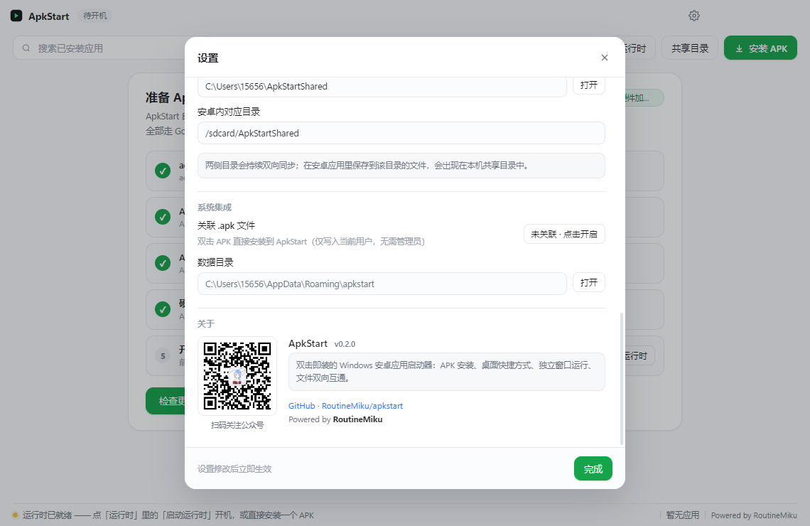
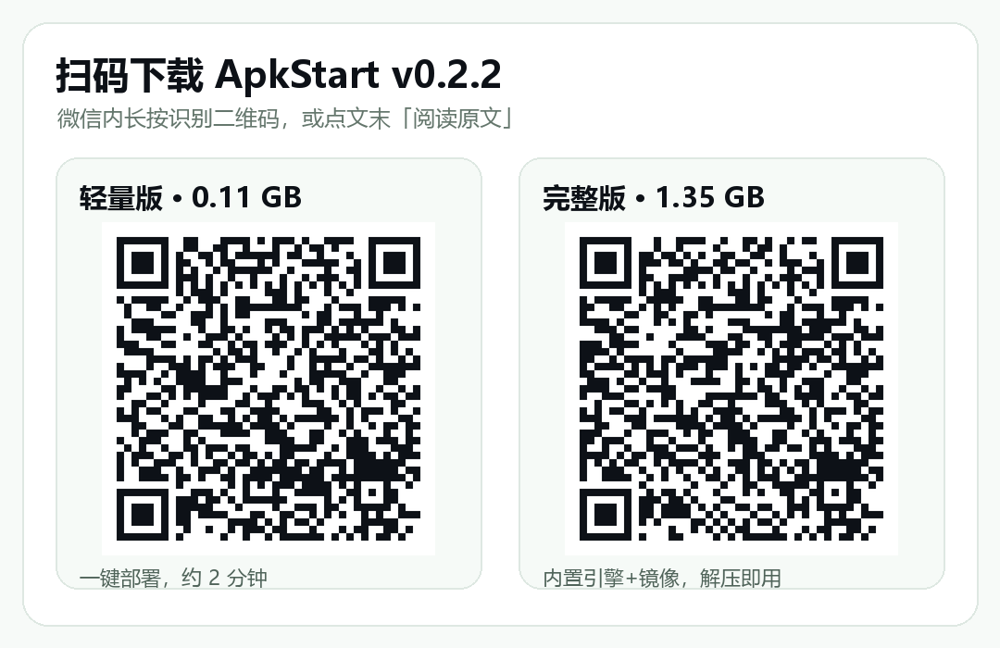

# Nhấp đúp .apk là chạy ứng dụng Android ngay trên máy tính

Muốn mở một app Android trên Windows, thường bạn phải trải qua: tải trình giả lập nặng vài GB → cài môi trường → tìm APK → kéo vào trình giả lập → chịu đựng popup và quạt quay ầm ĩ. Cài xong vẫn có thể nhận về một câu `INSTALL_FAILED_NO_MATCHING_ABIS` — gói này chỉ có thư viện native ARM, không cài được.

Thế nên mình tự viết một cái: **ApkStart**.

Đây là một trình khởi chạy ứng dụng Android cho Windows cực kỳ nhẹ: liên kết `.apk` với nó, **nhấp đúp là cài**, tự tạo lối tắt trên desktop, mỗi ứng dụng một cửa sổ riêng, giữa máy tính và Android còn có thư mục dùng chung để kéo thả file hai chiều.

## Bốn tính năng, cài xong là dùng

**① Nhấp đúp để cài.** Sau khi liên kết `.apk`, nhấp đúp là cài, tự đọc tên và biểu tượng ứng dụng, tạo lối tắt trên desktop trong một bước, không cần mở bảng điều khiển trình giả lập nào.

**② Cửa sổ riêng.** Mỗi app chạy trong cửa sổ co giãn tự do của riêng nó (`am start --windowingMode 5`), không làm phiền nhau, sắp xếp như chương trình Windows gốc.

**③ Chia sẻ file.** `%USERPROFILE%\ApkStartShared` được nối thông với thư mục dùng chung bên trong Android, kéo file trên máy tính vào là mở được ngay trong app.

**④ Engine chính thức + tăng tốc phần cứng.** Nền tảng bên dưới là Android Emulator chính thức của Google cùng driver AEHD, tải song song 8 luồng từ nguồn chính thức, các thành phần runtime do chính chương trình kiểm tra và quản lý, lớp vỏ không phụ thuộc bên thứ ba nào.

## v0.2.2: lần này dẹp hẳn "phiền phức"

Bản mới làm được hai việc.

**Một là bản đầy đủ mở ra là dùng.** Trước đây lần đầu khởi động phải bấm "Triển khai một chạm" để tải engine và image (khoảng 2 phút). Giờ bản đầy đủ đóng gói sẵn tất cả vào gói cài đặt: engine runtime, platform-tools, driver AEHD, cùng image tương thích Android 14 có lớp dịch ARM. Giải nén, nhấp đúp `ApkStart.exe`, bốn mục kiểm tra đều xanh, vào thẳng giao diện chính — **không tải gì, không cần cài đặt**.

**Hai là chạy được app hệ ByteDance.** Trước đây những gói chỉ có arm64-v8a như Hongguo Short Drama, trên image API 30 cũ cứ bấm đồng ý chính sách quyền riêng tư xong là crash (`DoBadTrampoline` của `libndk_translation`). Sau khi đổi sang image Android 14, lớp dịch mới đã giải quyết vấn đề này: test thực tế cài đặt thành công, vào được luồng đề xuất, video phát bình thường, vuốt chuyển video không crash.

Chỉ cần bật "Chế độ tương thích ARM" trong cài đặt là xong, các ứng dụng chỉ-ARM thông thường cũng được hưởng lợi. Một số ứng dụng có cơ chế phát hiện giả lập sâu hơn (kiểm tra cảm biến / baseband thật) vẫn có thể bị hạn chế, điều này xin nói rõ.

## Tải về: hai phiên bản, tùy chọn

> Bài viết WeChat Official Account không hỗ trợ đính kèm file cài đặt, nên ở đây đặt **mã QR dẫn thẳng tới gói cài đặt**: nhấn giữ để quét là tải được; cũng có thể kéo xuống cuối bài bấm **"Đọc bài gốc"** để vào trang GitHub Release.

| Phiên bản | Dung lượng | Phù hợp với ai |
| --- | --- | --- |
| Bản nhẹ `win64-portable.zip` | 0.11 GB | Lần đầu khởi động bấm "Triển khai một chạm", tự cài engine và image, khoảng 2 phút |
| **Bản đầy đủ `win64-full.7z.001` (khuyên dùng)** | 1.35 GB | Tích hợp sẵn mọi thành phần và image tương thích ARM, giải nén, nhấp đúp là dùng, không tải gì, không cần cài đặt |

Bản đầy đủ là file 7z chia phần, dùng 7-Zip / WinRAR / Bandizip giải nén `.001` là được; phiên bản hiện tại chỉ có một phần. Cả hai phiên bản đều là portable, không cần quyền quản trị để cài.

Dự án hoàn toàn mã nguồn mở, địa chỉ: <https://github.com/RoutineMiku/apkstart>. Rất hoan nghênh Star, Issue và PR; sau này phát hành bản mới chỉ cần gắn tag, GitHub Actions sẽ tự build và phát hành cả hai gói.

## Về tác giả

**ApkStart do RoutineMiku phát triển và bảo trì**, Powered by RoutineMiku.

Mã QR của WeChat Official Account và Douyin đều đặt ở bên dưới, cũng có trong mục "Cài đặt → Giới thiệu" của phần mềm, gặp vấn đề gì cứ tìm mình nhé.

Tài khoản Douyin **RoutineMiku (日常MIKU)**, liên kết trang cá nhân: <https://v.douyin.com/9TIIxVCANig/>

---

*Dự án sử dụng giấy phép MIT. Các thành phần runtime của bản nhẹ được máy người dùng tải theo nhu cầu từ nguồn chính thức của Google; bản đầy đủ đóng gói sẵn cho tiện, các thành phần liên quan tuân theo giấy phép riêng của từng thành phần.*
